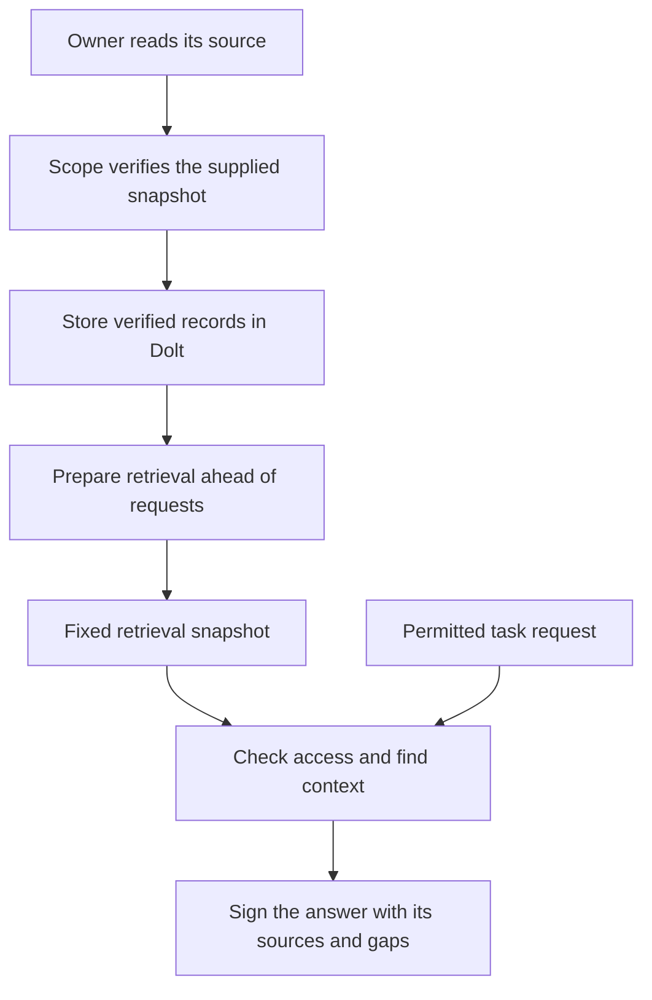

# How a request gets its context

Scope's design lets a caller ask about a task without opening the original sources. Owners read their records and send Scope copies. Scope checks what the caller may use before it searches those copies. The service and contracts are still planned. The [development guide](./development.md) builds the current library.

In the [equipment-order example](https://rawthoughts.in/scope/context-for-a-task/), the owner supplies approval revision 3 and report revision 7, which says part of the order arrived. While the caller prepares the update, report revision 8 arrives. The request needs a consistent view while Scope prepares a newer one for later requests.

Dolt is the planned durable store for accepted records and Scope's receipts. Retrieval indexes are rebuildable views of those records, access rules and a released retrieval policy. Changing an index can change which passage appears first; it cannot change the order approval or make a restricted report accessible. The retrieval backend still needs to be chosen by benchmark.

## Owners hand Scope snapshots; Scope never reads a source

An adapter runs in the source owner's own environment. It reads the repository, mailbox or application and produces a secret-free snapshot with a size limit. Its manifest identifies the records, revisions, observation times, validity, classification and origin. Content hashes bind the submitted bytes. Scope checks the owner's signature or an explicitly delegated adapter's signature before accepting them.

A familiar path, account or local process does not establish ownership. Keep credentials and provider commands outside Scope's schemas, errors and logs. If the adapter cannot supply a source, Scope must report the gap rather than crawl the original itself.

The adapter stages a complete candidate privately. Scope checks it before making one new generation visible, so readers continue to see the previous supplier report while its replacement is checked. Producing an export and accepting it are separate events. A caller needs the accepted generation to know whether its update has arrived.

Leaving an item out of an export does not delete it. Removal needs a **tombstone** from someone with permission to withdraw the record. A policy may generate that tombstone from absence only for a verified complete export. The design specifies that exception for website exports. Other sources need their own policy, schema, adapter and tests. The supplier report therefore requires an explicit removal record.

## A context bundle explains itself

Scope signs one context bundle for each answer. The bundle names the items, source revisions, observation times, validity periods and important gaps. It also points to the record of how Scope chose the items. To obtain a larger or fresher answer, make a new request. Leave the earlier signed bundle intact.

For the order update, keep approval revision 3, what report revision 7 says and the missing arrival estimate. Ask the supplier for the estimate. If a useful passage was left out for space, try a narrower question or allow a larger response. Explain the difference without revealing sources the caller cannot see.

Extra quotations can bury the current approval. Put required and explicitly pinned items first, within the caller's permissions. If the response limit is too small to keep them, say what requirement could not be met. Return a partial result only when the request permits it. A task that needs no context can say so.

Each search method proposes candidates, and fusion combines their rankings. The separate A-MAC-lite item scorer uses content type, how recently someone accessed an item, novelty and verified reports of use. A high score cannot establish whether a supplier's report is true. Keeping these mechanisms separate from source records lets developers compare retrieval changes without rewriting those records.

## Eligibility comes before ranking

Check what the request may use before searching or ranking. Eligibility includes the caller, controller scope, relationship, purpose, classification, source validity, age, revocation, deletion and permission for model processing. Apply those checks during graph walks and model-assisted retrieval too. Filtering only the final answer is too late if excluded material has already influenced it.

An order for one client cannot become eligible for another client's update because the wording is similar. A record permitted for internal drafting may still be forbidden for model processing or publication. None of these permissions authorises an external action.

Each instance serves one **controller scope**, which identifies who controls the data, what the instance may hold and how it may use it. Integrators must show why the caller and sources belong there. A company name, website, folder or shared machine cannot establish that.

## Freshness follows source revisions and validity

Use the source's revision, observation time and validity policy to decide whether it is current enough. A recent import cannot make an old delivery report fresh. Before answering, compare the snapshot's revisions with accepted revisions, check the request's age limit, and recheck access, revocation and deletion.

If a task requires today's delivery position and no permitted source supplies it, stop the drafting or analysis that needs it. If the context was optional, the owner's signed policy may let the work continue. Record what was missing and acknowledge the limited result. Calling the work a draft cannot grant permission. A task that needs no context can proceed without a bundle.

The [product freshness guide](https://rawthoughts.in/scope/keep-context-current/) explains what an old report can still support.

## Every request reads one frozen snapshot

A compiler prepares a retrieval snapshot before the request arrives. It uses the records Scope has committed, the released retrieval policy and the access rules for those records. Each request pins one snapshot, keeping it fixed while it reads. This keeps approvals, reports and permissions from drifting out of step during the request.

Accepting report revision 8 does not rewrite a request already using revision 7's snapshot. The next request can use the newer snapshot once it is ready. Whether the first request may finish depends on its freshness requirement and any access changes. A routine index replacement can let existing readers finish. If access has been revoked or a record deleted, Scope must withhold the affected result.

Compiling in advance keeps index building off the request path and lets you reproduce a result from the same inputs. Measure how long it takes for a verified update to appear in a ready snapshot. A watcher, webhook or timer can prompt a check. Only a verified update can change what Scope has stored.

Rollback must check an older snapshot against current access and invalidation rules, then activate it with a new increasing activation marker. It cannot restore an old grant or deleted material.

## Scope works with no model at all

::::tabs

:::tab "Strict mode"

Strict mode finds candidates by reference, keyword and links between permitted records, using fixed rules. It excludes model-generated summaries, embeddings and inferred links, even from the cache. It must start, recover and answer without a model service.

:::

:::tab "Full mode"

A memory host with separate processing permission would supply embeddings, candidate links, summaries or reranking. This can find passages whose wording differs from the question. Keep the source and model identity for each result so it can be removed when an input changes.

:::

::::

Both modes check what the task may use before they search. In the integrated design, Pale carries the request and connects to Counsel's Memory and Embedding Host. Permission to use that host does not extend to Counsel's separate judgment service.

Standalone Scope uses its own grants and revocations. In full mode, it links Pale's Counsel port library and calls the memory host selected in its own configuration, without a Pale daemon. The host separately checks permission to process the supplied material; a Scope retrieval grant does not grant that permission. This connection is part of the planned design. The kernel crate has no memory-host connection.

When the memory host is unavailable, fall back to strict mode only if the request's policy permits it. Identify that change in the result. A request requiring full mode must fail, not return an empty success or reuse cached model material as “strict” context. The [product mode guide](https://rawthoughts.in/scope/strict-and-model-assisted-context/) explains how the distinction affects a task.

## Use is reported, and outcomes are separate facts

After receiving a bundle, the caller reports which items it used. Scope checks and signs an acknowledgement. The report might show that a draft used the delivery report. It cannot establish that the delivery claim was correct or that anyone approved the draft. Keep issuing the bundle, delivering it, showing it to a model and using it as separate events.

A later read returns the same signed bundle the caller used if access still permits it. A refresh creates a new bundle. Connecting use to an execution episode still needs its own published identifier. A caller must never substitute its local run ID.

## Nothing improves itself

Scope records what it considered, what it returned, what it left out and what the caller reported using. These records help compare retrieval policies. Frequent use alone cannot show that an item helped. An agent might quote an outdated report or succeed without the extra context.

Use the comparison to propose a change. A person reviews it before release, and making a release active is a separate step. The optimiser cannot edit its own evaluation or widen access. A better retrieval policy changes rankings and indexes. The earlier source records stay intact.

## What Scope is not

Scope supplies context and keeps its own records of who could use it and who reported using it. Source access, credentials, scheduling and external actions stay with their owners. A signature tells the caller who issued the bundle. Check the source for truth and obtain separate permission to act.

Correction or withdrawal must reach dependent snapshots, bundles, embeddings, summaries, learned links and caches. Deletion removes source-derived material and keeps only the history and receipts policy permits. An old decision may then become impossible to reconstruct. Restoring a backup cannot revive revoked access or deleted context.

The [product correction guide](https://rawthoughts.in/scope/keep-context-current/#a-correction-is-not-permission-to-keep-another-copy) explains the source owner's part in that consequence.
