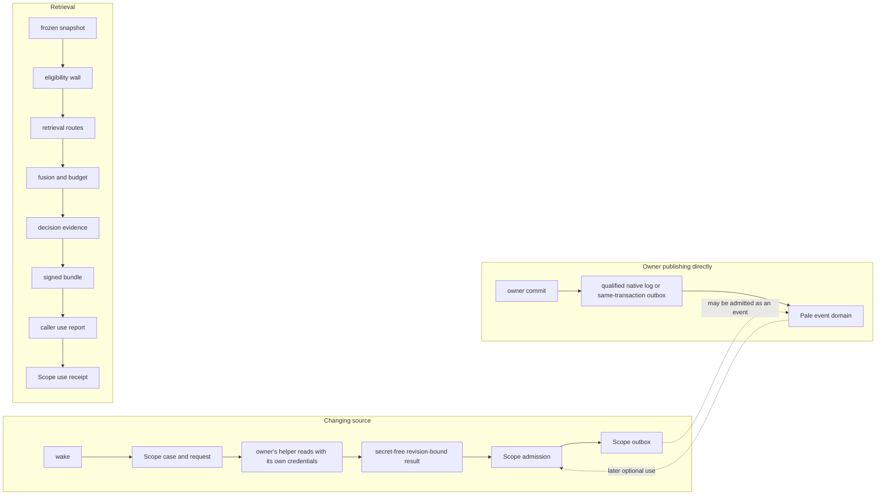

# Architecture

Scope keeps a derived account of an owner's work from snapshots supplied by each source owner. It answers bounded requests against that account and leaves access to the original and any external effect with the native owner. Scope's [standalone service-output signer](admission-and-trust.md) proves who issued its own bundles. The [engineering front door](README.md) connects this design to the build and development guide.

## Scope owns derived context and nothing else

Scope maintains its accepted context and the evidence needed to explain an answer: source snapshots and provenance; revisions, supersessions, tombstones and freshness; visibility under the owner's rules; and the retrieval policy, frozen snapshot and selection decision. It also keeps its episode records, receipts for admitted caller reports of use, and the proposals and releases for its own improvements. Scope defines the records for context resolution, source imports, episodes and research exports, and publishes and verifies its own half of admission.

The source owner keeps source reads and writes, provider connectors and credentials. Each other system keeps its own operational identities, callers, commands, assignments, leases, schedules and external effects. Scope has no credential vault and cannot change the state of Pale, Weave, Gas Town or another owner, accept a finding from Weave's Radar, or mint anything in Reckon's corpus. The one exception is a pointer: with Pale, Scope records in Pale's genealogy a pointer to what it gave an agent and stores the packet itself, and it never changes Weave's state or a source's records. The implementation must enforce those limits. A caller may ask an owner to change its own state; Scope never writes that owner's database.

Scope is also not a universal bus. Only resolution over Scope's admitted context flows through it. Handoffs between systems, event delivery, native reads and provider effects all keep their own paths, and work that needs no context never depends on Scope at all. Context-required work fails closed when required context cannot be resolved; context-enhanced work may continue only with its limitations visible; context-independent work proceeds as if Scope did not exist.

## Scope sits on Pale, Weave or both

In Scope's design it is the ecosystem's cache for context. It connects to Pale, Weave or both and keeps derived context over what they hold and the files they point to; it is never an independent source of truth. It is the only cache: if Pale and Scope each cached the same context, invalidation would have to be solved twice, at two points. Like a cache in any development stack it is optional, because work stays correct without it by reading the owners directly, and Scope makes that work faster and its context smaller. Pale's genealogy, the git history of context, is an append-only pointer map of the causal chain and not a second cache.

A cache needs something to cache, so Scope always sits on Pale, Weave or both; a Scope with neither beneath it is not a supported arrangement. Pale brings the genealogy, the history of what work relied on, what changed and what followed. Weave brings the context: its records and the files and sources they point to. Scope combines the two into the account an agent receives, and its role follows from which of them is beneath it. Where these pages say "standalone", they mean Scope without Pale, which then sits on Weave.

Without Pale, Scope is how an agent reads Weave. It consumes Weave through Weave's port, a read port still to be proposed by Scope's and Weave's builders, follows the pointers Weave holds to files and other sources, and offers the agent one account of the whole picture. Weave can serve its own MCP without Scope, but that surface reaches only Weave's own records; for everything else the agent reads the filesystem and other sources separately, and nothing then keeps that context consistent. Scope sits between the agent and Weave so that something does.

With Pale, Scope works like any retrieval system and what it returns depends on its reranker. Pale adds genealogy: Scope reranks as genealogy updates arrive, so what work relied on, what changed and what followed shape what an agent receives when Pale's hooks call it. With both, Scope reads Weave through the same port. Scope reads Weave and never writes Weave's state, and Weave never calls Scope. With Pale, Scope writes one thing: what it gave each agent. Scope stores the packet itself, the signed bundle, and Pale's genealogy holds a pointer to it rather than the full packet. Without that entry the causal chain would not show what the agent had when it acted, and Scope's next reranking could not learn from what it gave.

## One instance serves one data controller

Every Scope instance is bound to exactly one admitted controller scope, the isolation and admission key tied to whoever controls the data. That key is not a legal entity, the data controller of a website, an organisation in a CRM, a tenancy or a display name, and none of those is ever used to derive it. Sharing a repository, a company label, an operating-system user, a local socket or a role string creates no isolation. Two controllers never share one instance until a separate decision proves authority, transactional isolation, recovery and negative tests for that arrangement. The `projects` table therefore has no controller column by design: isolation is the instance boundary, not row filtering.

## Three paths touch Scope, and none stands in for another

The three paths certify different things, so each keeps its own records and its own failure behaviour.

**A changing source.** Something wakes Scope: a watcher, a poll, a message. Scope opens a case and a bounded request before anything is read; the case may hold idempotency, a deadline, the expected owner and profile and a freshness target, but never a credential. The source owner's own helper resolves its credentials inside its own process, reads the source and returns a secret-free result bound to an exact revision. Scope then validates, deduplicates, checks freshness, tombstones and conflicts, admits the projection and commits its new head together with a Scope outbox entry in one transaction. Pale may admit that entry as a derived-context occurrence, never as proof of the underlying source event. The wake proves nothing, the helper's success is not admission, and a stale, denied, conflicting or incomplete result waits, is quarantined or expires without touching the accepted head.

**An owner publishing directly.** The selected publication contract can send a committed owner fact to Pale from a same-transaction outbox or a qualified native log that proves the same commit and replay boundary. The owner can commit and Pale can admit that publication independently of Scope. Scope may later consume it under its own admission.

**Retrieval.** A request pins one frozen snapshot, passes the eligibility wall, runs the permitted retrieval routes, is fused and trimmed to budget, and Scope records its decision and signs the bundle. The caller later reports what it used and Scope receipts it. This path reads only Scope's own accepted and compiled state; it never opens a source owner's store, and it neither mediates the direct owner path nor waits on Pale's genealogy to establish Scope's truth. The mechanics are on [Retrieval](retrieval.md).

## Scope builds and signs every answer

Scope supports integrated and standalone admission. On the integrated route, Pale is Scope's only caller. It admits the caller's neutral request envelope together with its path, session, authority, disclosure, freshness and retrieval-budget ceilings, and later binds the exact returned result to that admission. Scope alone validates its own request body, builds the context bundle and signs its canonical bytes. Pale, a hook, an MCP server or a plugin may carry or render those same bytes; none may rebuild, normalise, widen or re-sign them, or call a separately resolved bundle equivalent. A bundle, once issued, is immutable: richer context needs a new request and a new signed bundle with its own relation to the first, never an edit.

Standalone Scope admits retrieval callers under [its own grants and signed requests](admission-and-trust.md); standalone imports use the enrolled source owner's permission under the [import contract](source-imports.md). Neither needs a Pale daemon, and standalone Scope reads Weave through Weave's port. Strict mode needs no model host. For full mode, Pale invokes Counsel's memory host for integrated Scope, while standalone Scope links the same port library and calls the host named in its own configuration. The host checks its own permission to process the supplied input; Scope's retrieval grant does not supply it. Counsel owns its host's permission checks, artifact admission and failure handling. [Retrieval](retrieval.md) defines Scope's use of the resulting artifacts and its fallback rules.

Pale pins only Scope's published contracts and carries admitted owner events to Scope's inbox, which deduplicates their references. Pale owns its half of the connection. A site owner may supply a signed export compiled by Gazette; Pale invokes Scope's import, and Gazette never calls Scope. Weave's requests likewise reach Scope through Pale. [Contracts](contracts.md) keeps the export requirements and the unresolved Weave consumer contract.

Integrated offline work follows Weave's schedule through Pale's governed execution, as [Improvement and go-live](improvement-and-go-live.md) specifies; standalone Scope keeps an explicit operator command. Through Pale, Reckon supplies the evaluation, curated case and preserved owner decision required for each learned promotion. The full go-live rehearsal exercises that chain and Counsel's integrated memory path and loss handling. Ordinary deterministic retrieval and standalone strict mode remain independent of those research services.

Owner-native memories stay where they are. Beads keeps each repository's `bd remember` and `bd recall` notes and Gas Town keeps its events and transcripts; Scope may resolve bounded references to them and never copies or changes those stores. Pale's genealogy and CodeGraph's index are likewise other owners' state.

## Code structure flows one way, from source through Pale

Scope is a semantic provider behind Pale, not a map of the code. Structural evidence moves in one direction: from the source, to the CodeGraph index, to typed evidence that Pale admits, and only then, optionally, into Scope as a reference or projection. Scope never writes CodeGraph's nodes or edges and CodeGraph never writes Scope. When Scope has a question about code, it hands Pale its query intent, a historical analogy, a known anchor or an unresolved question; Pale turns that into a bounded provider-neutral request, CodeGraph derives fresh evidence from the admitted source frontier, and Pale admits it before Scope may enrich anything.

Scope's graph keeps semantic projections with their exact sources, confidence, uncertainty and dependencies, never a clone of the code's call or import graph or of Pale's alignment and genealogy graphs. Scope's freshness answers only whether a projection still holds for the source revisions it declared; it says nothing about CodeGraph's index freshness, Pale's journal or an owner's transaction. A watcher or timestamp can request re-evaluation and never proves freshness. For Pale's adaptive work, Scope contributes bounded semantic and use lineage only; CodeGraph and SkillOpt are Pale's layers, and candidate output, evaluator output, settlement, custody, owner decision, release and activation each keep their own owner.

## The crates

The target is one Rust workspace. Rust is non-negotiable: the resolver sits on a hot path, memory safety matters for a service holding private context, and Gazette and Reckon's core use Rust. The repository manual owns the exact current and intended folder layout on its [development page](../development.md); this page owns the dependency direction and internal module design.

The design's kernel modules follow the flow from an admitted source to an explained answer. The kernel holds only its crate comment in `kernel/src/lib.rs` today, so this is the target structure and no module below exists:

| Responsibility | Modules under `kernel/src/` |
| --- | --- |
| Keep the source-qualified graph and subject context | `graph.rs`, `people.rs`, `resources.rs`, `git.rs` |
| Persist and query accepted state | `db.rs` (Dolt on port 3309), `registry.rs`, `semantic_ledger.rs` |
| Compile and materialise frozen retrieval state away from live requests | `retrieval_compiler.rs`, `materialization.rs` |
| Plan and answer a request, from eligibility to the signed bundle | `resolver.rs`, `planner.rs`, `retrieval_routes.rs`, `fusion.rs`, `affinity.rs`, `retrieval_decision.rs` |
| Admit owner snapshots and reconcile accepted generations | `projection_admission.rs`, `source_snapshot.rs`, `sync.rs` |
| Record episodes, reported use and scoring | `episodes.rs`, `receipts.rs`, `scoring.rs` |
| Enforce identity, scope, visibility and freshness; report failures | `guardrails.rs`, `error.rs` |
| Hold generated Protobuf projections | `generated/` |

In the design a `sources` module registers versioned adapters and validates source provenance. It stays open to new source kinds rather than becoming a closed enum of four sources. `graph.rs` rebuilds its typed nodes and provenance-bearing edges from accepted state; it is not another source of truth.

The workspace dependencies are petgraph, mysql_async, prost and prost-build, tokio, thiserror, secrecy, clap, tracing, serde and serde_json, sha2, pyo3 and maturin for the Python binding, and a reviewed local-IPC implementation (tonic is one candidate). `axum` is feature-gated to the optional restricted browser loopback adapter and is never the native caller path. `secrecy` protects only genuinely sensitive Scope-local material; no provider secret ever enters a Scope schema. A pidfile may help an operator notice a duplicate start, but the write lock is the transactional fence on [Durability and recovery](durability-and-recovery.md).

The kernel crate builds independently. Scope's budget implementation is to use MONAD's formal types, with Reckon behind a default-off integration feature. Scope and Pale's core profile must work without the Reckon feature. Successor-model questions involving MUON or HENA remain separate Causality research.

The [native development guide](../development.md) owns the build commands. Implementing the workspace, bindings, schema generation and synthetic-fixture recipes requires their own working commands and checks; the architecture alone supplies none.

## Storage: independent stores, one per owner

Dolt is Scope's planned store for its accepted state. The deployment profile described here names its binding `memory` on port 3309. Scope's daemon owns writes and its typed operations are the consumer surface; agents receive no raw SQL access. Pale supervises the daemon in the integrated profile, while an operator starts it standalone. Dolt history supports inspection. Scope owns its ledger of provenance, tombstones, inbox, episodes and receipts, and must prove crash recovery. The separate [retrieval benchmark](retrieval.md) selects the rebuildable reader backend.

Scope's guarded periodic bulk imports update its [source-qualified identity and project projections](data-model.md). Its deployment backs up accepted state before a sync and follows [its own durability and recovery rules](durability-and-recovery.md) when restoring it. Scope owns its sync and proposal policy. Before a proposal branch is allowed, that policy names the proposer, permitted schema and rows, expected starting revision, transaction and version-commit boundaries, reviewer and acceptance conditions, conflict and rebase handling, external-effect limits, retention and backup evidence. An authorised proposal records its SQL transaction and explicit Dolt commit; review compares the exact schema and row changes before acceptance. A branch grants no permission and cannot reverse an external effect.

Gas Town owns its separate store and lifecycle and may supply optional owner projections. Means calculates beside Pale using owner-held facts and Pale's reusable methods; the engine keeps no store or service of its own. The owner's workspace selects permitted sources, grants and Packs and retains each owner's run snapshot, results and run record. Scope imports only the references or projections an owner selects from those retained runs. It keeps the original source references and rechecks permission, freshness and retention limits; it never rewrites the saved calculation. Each owner sets its export cadence. [Source imports](source-imports.md#each-source-reaches-scope-through-its-owner) explains how those records enter Scope.

A port is a chosen identifier, not proof of a listening service, and `memory` on 3309 chooses no path. The absolute runtime root—the Dolt data folder, non-secret source routes and configuration naming the Dolt address—comes from the deployment owner's approved machine binding after its security checks. It is never a folder holding credentials, and no bootstrap or import may treat an old private data folder as Scope's runtime root. Source owners choose where their durable agent memory lives and supply permitted memory to Scope like any other source. Deleting or rebuilding a retrieval index leaves that memory intact. A subject folder does not by itself require a separate daemon or database, widen access, or establish that its contents are original history. Capacity is never inferred from anecdotes or node counts: the exact Dolt binary, schema, concurrency, visibility filters, import sizes, recovery and isolation profile are benchmarked directly, and the mysql_async driver's behaviour with transactions, Dolt procedures, cancellation and timeouts counts as unproven until integration tests run against the pinned binary.

Scope reads no provider bindings and no data directory from any earlier deployment: its runtime root comes only from the approved machine binding.

## Transport never confers identity

The daemon uses a deployment-selected authenticated local transport, such as a Unix domain socket. An optional restricted loopback HTTP and WebSocket adapter serves only an admitted browser plugin. Neither the socket path nor the port is a cross-system constant, and neither the transport, the peer's operating-system user nor a caller-declared role counts as admission. The external protocol is Scope's own versioned request and response schemas over that transport. The daemon's operations are resolve, source import, exact-bundle read, context-use report and receipt, episode observation, an operator-only projection reload and health; the diagnostic stream is on [Diagnostics](diagnostics.md).

## Where to go next

The record shapes and signing are on [Contracts](contracts.md), the graph and tables on [Data model](data-model.md), how one file in many places is modelled on [Resources and locations](resources-and-locations.md), and how owner snapshots become visible on [Source imports](source-imports.md).

Part of [Scope engineering](README.md).
