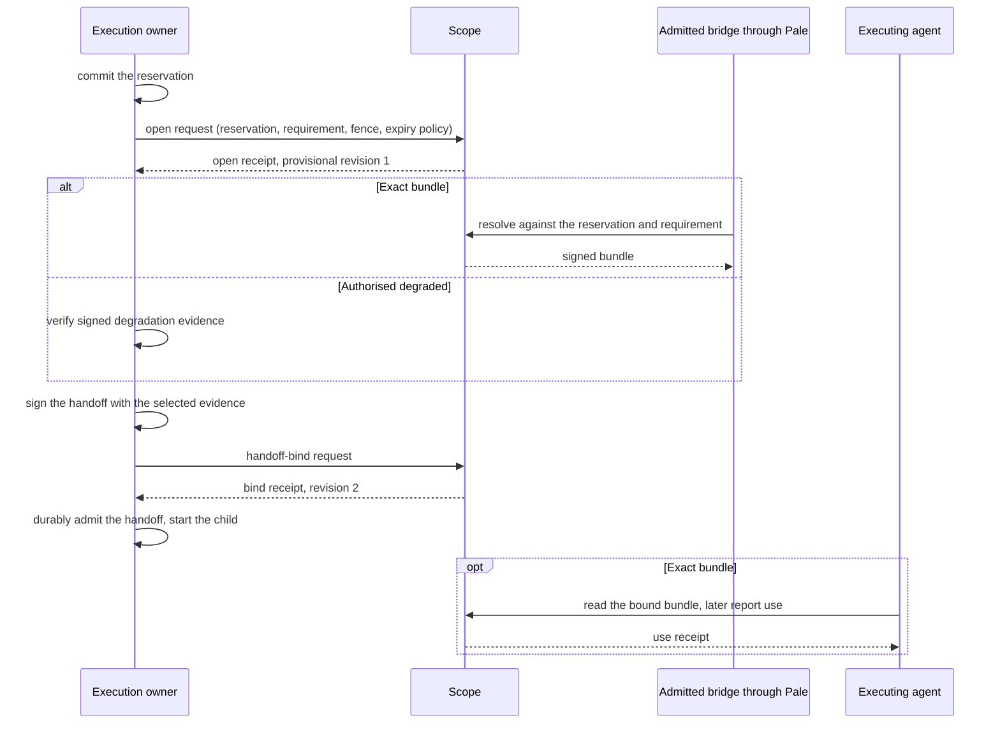

# Episodes and use

Scope must distinguish sending a context bundle, reading its exact bytes again, a caller reporting that it used them, a model actually receiving them, the work's outcome and the owner's acceptance. Each event needs its own evidence. A receipt for one event cannot establish the others.

The independent contract covers resolving context, reading the same bundle again and recording use reports under either standalone or integrated permission checks. An execution episode connects one run to its selected context variant and to the owner's outcome records. That path requires a concrete run-identity proposal, approval by the responsible owners and their published successor contract; the issuing-owner question remains open below.

## The task's owner says how much context the work needs

A context requirement is signed by the owner of the task, never by Scope; Scope owns only its vocabulary and validation, and cannot let work continue by issuing its own requirement. It names the task, one of three classes, the scope, role, purpose and classification ceiling, the required and optional sources with their consistency class and freshness requirement, a token or size budget, and the context variants the task accepts.

| Task class | Variants it may accept | Rules |
| --- | --- | --- |
| Context-critical | An exact bundle only | At least one required source; no degradation policy |
| Context-enhanced | An exact bundle, or an authorised degraded answer | Degradation only with an immutable degradation policy |
| Context-independent | Independence only | No required source; keeps its authority reference |

Source arrays are sorted by source, duplicate-free, and never unbounded when empty. A resolve request tied to execution must be the same as or narrower than the requirement it references; its own query and budget fields cannot widen the signed policy.

<a name="scope-context-freshness"></a>

## Freshness is the owner's word; required context fails closed

At handoff and again when dependent work uses the context, check each required source's owner, role, exact revision and delivered bytes, permitted recipient and purpose. Recheck observed and valid-through times, expected refresh cadence, dependencies, contradictions, deletion and revocation. Selecting, capturing and observing that a recipient received a source are separate facts. A missing, stale, denied or oversized required input holds the dependent decision unless the owner permits a narrower task. Scope first tries a lineage- and genealogy-aware refresh from the source owner. Changed bytes need a newly accepted task association, never silent replacement in the original handoff. Any source repair follows the [owner's separate effect and read-back](resources-and-locations.md). The task owner's signed requirement binds the permitted degradation policy; that variant still needs its own required acceptance records. The receipt records the actual limitation. Changes to authority, canon or lifecycle count as effects.

Test optional-source omission, one missing required source, selection by the wrong owner, an insufficient budget, a handoff delayed past expiry or revocation and a still-valid handoff. Exercise a refresh with new bytes and the separately admitted successor. For a permitted reduced variant, withhold each required acceptance record and substitute one from another handoff or expired generation. Refuse dispatch when its evidence is missing; failure of the assisted path cannot authorise context-independent work.

| Kind of work | If refresh or repair cannot restore the context |
| --- | --- |
| Public, reversible drafting | Continue only as context-enhanced work with a signed degradation policy and an explicit receipt |
| Internal analysis with optional context | Continue only under the signed degradation policy, with limitations visible |
| Confidential analysis or drafting | Apply the signed degradation policy and disclose its limits. Effects, irreversible disclosure, changes to authority, canon or lifecycle, and native mutation remain outside this degraded path |
| Context-critical work | Stop until freshness is restored, including when the work is analysis or drafting |
| Confidential, legal, financial, policy, publication or effectful work that requires the missing context | Stop until freshness is restored |
| Engineering recovery | Use the pinned repository or workspace evidence the handoff names. A signed context requirement still applies |
| Context-independent | Proceed without Scope |

Degradation here covers missing source context. An assisted launch still needs both Scope episode receipts described below.

## A bundle is read back as the exact bytes that were bound

Reading a bundle retrieves one already signed bundle; it performs no traversal and cannot substitute a newer one. Work tied to an execution must present the complete execution binding (the episode identity, attempt, authorisation, reservation, fence, handoff, requirement and context-binding hash) as one object, and Scope checks the exact successful reservation, handoff, exact-bundle binding, caller and session scope and bundle signature before returning the bytes. Reads outside execution omit the binding. Scope checks its own grant and request admission in standalone mode and Pale's common request in integrated mode. A partial binding is invalid in either mode. A refresh that changes the bundle needs a new admitted request, and when execution-bound a new execution generation and handoff, never a mutation of the old binding. Later enrichment needs an exact Scope-published relation to its base bundle; it cannot replace or retroactively satisfy the original required bytes.

Check current disclosure authority and source invalidation at delivery, including after restore and on a retry. A valid signature proves what was issued. A prior read or use receipt records its own event. If the bundle has since lost eligibility, refuse the exact read and retain only the historical evidence its policy allows. [Snapshot freshness and revocation](retrieval.md#freshness-is-checked-at-request-time)

## Use is reported by the caller and receipted by Scope

The caller submits a use report naming the bundle and its digest, the caller, the use scope, the task, which items it reports consuming or ignoring and why, the artifacts it reports generating, and any staleness it observed. Only the deferred execution-bound branch carries an execution binding, and it requires the complete object. In standalone mode the report is the body bound by the request admission. In the Pale mode it is the body of the caller-signed common request. Scope validates and deduplicates durably before signing the receipt. The report carries no admission or receipt hash. The receipt binds the admission and the SHA-256 of the report's canonical form as submitted.

An accepted receipt records Scope's validation of the admitted caller's report. It echoes the bundle, caller, use scope, task and the reported items and artifacts. The use scope must match the request and admission. An execution-bound receipt, in the deferred branch, also echoes the complete execution binding and verifies scope against the handoff, session grant and requirement. A `duplicate` names the original receipt and echoes its accepted evidence. A `rejected` receipt carries a bounded reason and no accepted evidence. Pale's federation members in the binding are both present or both absent, and reusing a report identifier or admission with a changed body conflicts. Golden vectors cover empty optional evidence, changed scope, reordered items and `null`. The deferred branch also needs exact and partial execution-binding cases. Model visibility takes separate harness evidence. Outcomes and causal claims require their own evidence.

## An executing agent reads the context already bound to its handoff

The executing agent reads the exact bundle bound to its handoff through an authenticated request. It later reports which items it used and receives Scope's receipt. The command forms below are the design of the command line; none of it exists yet, because the kernel is an empty library. [Native development manual](../development.md)

```text
scope read --request-ref <authenticated bundle-read request> --format json
scope report-use  --report-ref  <context use report>
```

Provider commands and credentials go through separately admitted Pale or owner capabilities; Scope offers neither. An agent cannot issue a fresh first-turn resolve and claim that the handoff bound its result. Context survives session rotation and compaction by re-reading the same immutable bytes, never by history or a silent refresh. How many tokens a model's context window holds, how a harness compacts and what rate limits apply are facts about the selected harness and model; Scope obeys the declared bundle budget with headroom and holds no universal allocation. A pre-run injection of the same bound bytes, where an execution owner offers one, may never resolve, refresh or substitute different bytes. Any Skill that teaches this procedure is owned and released outside Scope, and Scope may only propose changes to it.

## An episode is opened before resolve and bound once to its handoff

For work tied to an execution, the order is strict:



Scope opens revision one with the exact reservation, requirement, fence, expiry policy and clock basis and no context evidence. The open receipt must match the reservation and fence before either assisted branch proceeds. An exact-bundle handoff binds the signed resolve result. An authorised-degraded handoff binds the named policy's signed degradation evidence and has no resolve, bundle read or use receipt of its own. A limited retrieval result still needs exact-bundle admission if the handoff binds its bytes.

Scope admits the bind request only against revision one with empty context evidence. It advances the open episode to revision two with exactly one context variant matching the handoff and signs the bind receipt. Both assisted variants need that receipt before dispatch. A context-independent handoff carries the owner's signed classification and creates no Scope episode, bind, bundle or use receipt.

Both requests are typed bodies inside a caller-signed common request issued by the admitted execution owner, whose identity must equal the reservation's issuer. A bridge may carry or verify the owner's signed request. One episode identity can have only one initial revision. Scope returns the original receipt when an admitted replay matches the original open request identifier and digest. A new open request for the same episode, or changed bytes under the original identifier, conflicts. For binding, Scope matches the request identifier and digest on replay and checks the exact expected revision and digest for a new request. A new bind request after a successful bind conflicts. `committed` requires every committed-episode field, and `conflict` or `rejected` forbids them. The revision, request and receipt commit together. Each episode binds one handoff. Later revisions preserve the context evidence, reservation, handoff and binding hashes byte for byte and may only append outcome and use evidence.

In the deferred branch the store keeps the complete canonical signed bytes of each episode revision and a head keyed by the selected identity. Normalised indexes must match the parsed signed record before commit. An append and head advance commit together, comparing both the prior revision number and digest. A failed swap rolls both back. Diagnostics and scoring stay outside the signed record.

## An episode ends once, either closed or expired

Before closing an episode or recording late terminal evidence, Scope verifies the execution owner's native commit and matches the event to the exact episode, attempt, fence and handoff. A provisional open has no handoff to match. The carrier's observation and an organiser's acceptance are separate records. Scope commits the episode update and inbox disposition together and returns the original disposition on exact replay.

Expiry and closure compete to advance the same revision. Only one can commit a terminal transition. A closed record has a closing time, an expired record has an expiry time, and either terminal state stays fixed. Expiry needs an accepted Pale request bound to the exact open revision, expiry policy and clock evidence. It succeeds only when the evaluated time reaches the policy deadline and the expected revision still matches. Exact replay returns the recorded disposition. Reusing the request identity with changed bytes is refused. A schedule declared in Weave may invoke the check through Pale, following Weave → Pale → execution. The owner's policy supplies the deadline, reason and clock basis, and Scope signs the resulting revision. A process clock, mutable timeout table or adapter's wall clock cannot substitute for that evidence.

A terminal event that arrives after expiry is kept in a successor revision as late evidence. It cannot rewrite the status, mint a closing time or become scoring or authority evidence automatically; its review fields stay absent until an applicable authority admits it for a bounded purpose, and even then the lifecycle does not change.

## Outcomes are several facts, never one score

Process termination, a verifier's result, acceptance of the task, acceptance by whoever organised it, the owner's approval and satisfaction of the goal are separate owner facts. They answer different questions: a later approval does not erase a failed verifier, and a successful attempt does not imply acceptance or satisfaction of the goal. The owner's observed outcome takes priority over a labelled proxy answering the same question; reported use, a model's judgment or frequent retrieval cannot replace it. Each outcome may be appended to a closed or expired episode in a successor revision without overwriting another, imposing an order across different questions, rewriting the source event or reopening the work. Missing evidence stays missing.

Any scalar used for evaluation is a versioned projection for one declared question, never accepted truth. The initial feature map for terminal process categories is a successful finish as +1.0, a failure as −0.5, a timeout as −0.3 and a cancellation as 0 with no credit; it lives in the scoring configuration, changes only through a Scope proposal and release, and never changes the source event or the episode's own lifecycle. Where coordination work is later evaluated, three dimensions stay separate: how useful the coordination was, what it cost, and whether the owner's stated goal was met. Scope preserves references to each and never mints a goal-level approval or a second graph of goals; the owner-published acceptance and satisfaction evidence it would join is still to be defined.

## Which owner gives an episode its identity is still open

The issuing owner and successor run-identity contract remain open decisions. The contract must distinguish an organiser's acceptance, such as Weave accepting parent work, from the executor's terminal event. Scope follows the approved identity and signs only its own revisions.

Until that contract is approved and published:

- Independently admitted requests can still resolve context, read the exact signed bundle and receipt reported use without an execution binding.
- Scope cannot open, bind or close an execution episode. The episode family and execution-bound request and receipt branches stay out of the independent contract checkpoint. Outcome-weighted scoring has no episode input.
- Evidence from a direct Claude Code or Codex path, or from Gas Town without an organising owner, may still enter a research export by exact owner references, and no episode is ever fabricated for it.

Three rules carry into whatever owner is chosen: outcome evidence stays several separate facts, resolving context never creates an episode, and an agent that loses its working memory re-reads the immutable bundle rather than trusting a summary. Scope's own continuity, separate stores for each system's memory, and its refusal to write another owner's store also carry over unchanged.

Part of [Scope engineering](README.md).
