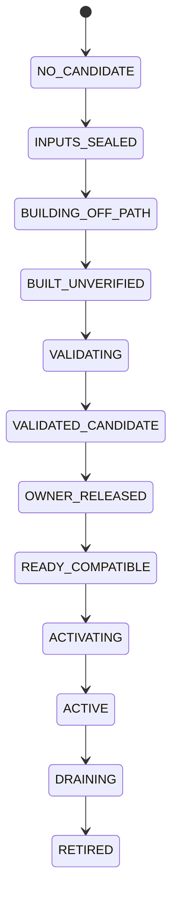

# Retrieval

Scope's retrieval design selects a small, useful and fresh context bundle from the material a request may use. Each request pins one frozen snapshot prepared away from live traffic, checks eligibility before ranking, and records what it considered and why. Retrieval settings may change candidate selection and order, but cannot change source facts or access permission.

Go-live requires the compiler, frozen snapshot and full adaptive rehearsal. The initial active policy uses deterministic rules; the learned machinery is rehearsed offline and stays switched off until a separate approved release and activation. The planner, evidence window, learning permissions and strict mode below form that accepted design. The local comparisons below decide whether a retrieval mechanism earns its place; research supplies candidates, not proof on Scope's workload. [Scoring](scoring.md) defines how eligible items are ranked.

## Retrieval may touch ranking, never truth

Retrieval state may affect which candidates are considered, their order, recall, latency and cost. It may not create or change a source's facts, revisions, deletions or effects; Scope's admission, provenance, freshness, contradictions or tombstones; Pale's events or Pale's genealogy, its append-only history of what work relied on, what changed and what followed; a caller's identity, eligibility or authority; any authorisation of work, owner ruling, release or activation; or the contents of Pale's packages or compiled generations. Scope keeps its state in four classes so that this line can be tested:

| State | How it is kept | Examples |
| --- | --- | --- |
| Accepted truth | Durable Scope transactions; recovery is authoritative | Admitted revisions, provenance, freshness, tombstones, bundles, use receipts, decision evidence |
| Released retrieval policy | Immutable releases with ruling, compatibility and rollback evidence | The deterministic planner, route, fusion and budget settings |
| Rebuildable projections | Content-addressed, disposable, rebuilt from sealed inputs | Affinity, keyword, vector and graph indexes, the frozen snapshot itself |
| Caches | In the running process only | Decoded blocks, query caches, transient scores |

Deleting the last two classes may cost quality or speed and must change nothing in the first class, in any source or in Pale's genealogy. The compiler must be able to delete and rebuild every projection without touching accepted records. If deleting a projection changes truth, the implementation has built a competing truth store and fails.

## One request binds many coordinates, and none is an alias for another

| Coordinate | Owner | What it establishes |
| --- | --- | --- |
| Source revision or frontier | The source owner | How current the source is |
| Scope's semantic head | Scope | Which admitted derived context is current |
| Scope's writer fence | Scope | That no stale writer can commit |
| Retrieval-policy release | Scope's responsible owner | The exact approved retrieval behaviour |
| Snapshot identity | Scope | The exact compiled projection bytes and logical digest |
| Permission and authority policy | The named authority, Pale or the standalone owner | The eligibility inputs |
| Pale's contract set and compiled generation | Pale | The integrated consumer binding |
| Pale's deployment activation fence | Pale | The order of Pale's local adoption |
| Genealogy frontier | Pale | How far causal accounting has progressed |

A counter inside one domain is never a content identity or proof of order across domains; the snapshot's manifest binds each exact coordinate reference and hash instead of inventing one global generation.

## Checks run in a hard order

```text
authenticated request
  -> controller, relationship, purpose, classification and model-use admission
  -> source validity, tombstones, revocation and freshness
  -> required context and explicit owner or user pins
  -> planning of the optional retrieval routes
  -> candidates from each route, inside the eligible set only
  -> deterministic fusion, diversity and budget
  -> durable decision evidence
  -> signed context bundle
  -> later: the bundle read, the use report and receipt, the outcome evidence
```

Nothing later can undo an earlier step. Affinity and planner scores stay below deterministic structural relevance, current responsibility and frontier, freshness and explicit pins; they can neither suppress mandatory context nor bring back an item the wall excluded. The exact task identity is the task reference; a derived task feature may exist only when its procedure, version, inputs, uncertainty, rights and expiry are recorded, and a label such as "code review" is never a global task ontology.

## Four routes search inside the eligible set

| Route | What it does |
| --- | --- |
| Exact | Looks up a stable Scope item, resource or reference, and any explicit owner pin |
| Keyword | Searches a pinned, model-independent index with deterministic tie-breaking |
| Graph | Walks Scope's admitted context relations only, within a bounded depth |
| Vector | Searches labelled model-made representations, only where the profile permits and isolation is proved |

An unavailable optional route reports itself as missing. It never returns an empty success and never changes eligibility.

## The first planner is deterministic

The first deployed planner finishes exact and pinned lookups and required-context work before choosing optional routes. Its rules depend on the request: exact lookup for IDs, keyword search for names or phrases, graph search for connected context and vectors for semantic wording where model use is permitted. Per-route and total budgets limit latency, candidates, bytes and tokens. Results are merged by rank with stable tie-breaking, then diversified and trimmed to the response budget; required context and pins survive those steps.

An approved learned policy is compiled into the snapshot. It makes its permitted choices locally and repeatably; Scope does not call the memory host on every request to choose search methods.

Missing routes, timeouts and truncated candidate sets remain explicit. If more context would exceed policy or budget, the planner returns the permitted no-context, degraded or fail-closed answer. Reciprocal rank fusion is a comparison baseline, not a selected algorithm; its constants are benchmark work. A-MAC-lite scores eligible items and fills the response budget, without owning route planning, fusion or the snapshot.

## A compiler freezes one snapshot, off the live path

The compiler reads only Scope's accepted state, the exact released policy, the compiled permission and eligibility slice, the controller, purpose and model-use ceilings, the source and revocation frontiers, and pinned toolchain and dependency identities. It creates no semantic head, source revision, permission or genealogy edge; it pins those inputs and emits a rebuildable artifact with a manifest, validation evidence and a rollback anchor.



Apply the [forward rollback procedure](improvement-and-go-live.md#every-accepted-change-is-released-forward-and-can-be-rolled-back-forward) to the previous snapshot. Scope requires an authorised transition from active or degraded, a new snapshot activation fence and a recorded drain of the failed successor.

The build must resolve every input, contract pin, frontier, permission slice, policy release, toolchain and component preimage exactly. It runs apart from active readers. Validation then checks logical determinism, structural equivalence, counts, referential integrity, eligibility isolation and the declared performance margin.

A successful build or evaluation cannot release itself. The owner releases the candidate, and readiness checks compatibility with the running Scope and, for integrated use, Pale's consumer binding.

Activation changes Scope's head and fence atomically. New requests take the active snapshot; existing requests keep their pin until completion, cancellation or expiry. Retention protects those readers and every rollback target.

A build may wait for a missing frontier or permission slice, resources, an external model artifact, the owner's review, the [Reckon evaluation and recorded decision](evidence-export-and-reckon.md) required for a learned promotion, Pale's compatibility or old readers draining, and none of those waits permits partial visibility. Safe endings are a rejected input, a deterministic build mismatch, an invalid candidate, the owner's rejection, released but inactive, an incompatible successor, active, degraded, rolled back and retired. A partial build, mixed identities or an ambiguous activation is a dead path that goes to quarantine and reconciliation.

## Freshness is checked at request time

Compare a result’s recorded inputs before use, then rebuild, take a permitted fallback or stop the affected request.

Before using a snapshot, the request compares the semantic head, permission slice, revocation frontier and freshness the snapshot was built from with the current ones and with the request's own staleness limit. A match proceeds. A soft freshness miss on a request that only benefits from context triggers reconciliation or a rebuild, and if still allowed, an explicitly degraded answer with limitations. A miss on required context, revocation or permission fails closed. An older snapshot may be used after the head has moved only under an explicit consistency profile, and the decision records the exact gap. A snapshot touched by a tombstone or revocation on an eligible item is never reused for a new request, even though its file is immutable. Watchers, webhooks, polls, Nostr deliveries, file events and clock ticks only wake this comparison; none of them advances an authoritative head.

The snapshot pin fixes the request's inputs while it runs. Before issuing the bundle, Scope orders issuance against its effective permission, revocation and tombstone frontier. If an invalidation wins, withhold the affected result and use the request's declared refusal or separately admitted degradation path. A routine snapshot swap can let pinned readers drain under still-valid authority. Restoring a backup or rolling back the active snapshot cannot restore disclosure permission. A later [exact bundle read](episodes-and-use.md#a-bundle-is-read-back-as-the-exact-bytes-that-were-bound) has its own check. Only the source owner can widen an item's visibility through a new revision; narrowing takes effect immediately. Visibility limits what may enter a bundle and never grants permission to share it elsewhere.

## Four record meanings are accepted

**A retrieval-policy release** binds the owner's ruling and release identity, the base release and rollback anchor, the atomic component set (eligibility version, deterministic planner and gate, route profiles, affinity profile, fusion, diversity and budget profile, model-use ceiling) with each component's reference, hash, version and compatibility range, the training, evaluation and evidence references and limitations, the controller, purpose and profile it applies to, and its issuer, digest and signature. Components may carry separate versions, but activation selects exactly one compatible manifest; swapping one component alone is not an activation.

**A snapshot manifest** binds the exact semantic head and root, the released policy, the permission slice and revocation frontier, the controller, relationship, purpose, model-use and isolation profile, the source-frontier vector and when freshness was constructed, the compiler, toolchain, dependencies, features and build parameters, the keyword analyser and index identity, the graph representation, any vector and model identities, the affinity root, the logical and component digests, counts, size and validation results, the compatible Scope and Pale contract references, and its predecessor and rollback anchors.

**An activation receipt** records that one released, compatible snapshot became ready, active, degraded, draining, rolled back, retired or rejected under an exact activation fence, with predecessor and successor, reason, health and compatibility evidence and drain state. It never activates Pale.

**Decision evidence** is kept for every request: the request, caller, task reference, purpose and criticality profile; any task feature with its inputs and uncertainty; the semantic head, policy, snapshot and permission, revocation and freshness coordinates; the eligibility and required-context outcomes; the routes considered, invoked, skipped, unavailable or failed with reasons and budgets; the complete eligible candidate set; each route's candidates, scores and features; the fused order, required pins, selected and omitted candidates with reasons; degradation, isolation and model-origin markers; the bundle's reference, hash and creation state; and, joined later, the read, the use receipt and the outcome references. Bundle creation, delivery, reading, consumption, outcome, acceptance and settlement are distinct facts, and this record is Scope's evidence, not a causal edge. The bundle carries only the decision evidence's reference and hash.

## Decision evidence is kept, then lawfully forgotten

For a defined evidence window, Scope keeps the complete caller-visible eligible set, each route's candidates, features and scores, the selected and omitted results, the policy and snapshot identities and the outcome references needed for replay. The data owner's rights, purpose, privacy, model-use, expiry and deletion policy set the window. Deterministic logs without non-zero support or propensity evidence support observed replay and limited sensitivity analysis only. At lawful expiry or deletion Scope removes source-derived payload, embeddings, model summaries and links, active affinity and dependent caches. It retains only the hashes, tombstones, records of requests and results, and event references the applicable authority permits. Context use supplies no consent for evaluation, training, derivative models, reusable generalisation, disclosure or transfer outside the controller; each needs its own permission. Compaction or deletion of accepted context needs an owner-reviewed tombstone. Scope marks a decision unreconstructible when its replay inputs are gone. Deleting affinity or a snapshot changes no source fact; deleting, revoking or superseding semantic or source input invalidates every dependent snapshot, affinity feature and decision cache.

For deletion, bind the owner's decision, exact source revision, retention rules and holds, then trace every copy that can reconstruct, identify, return or influence use of the target: history, replicas, journals, indexes, features, exports, outcomes, backups and relevant keys. Check immediate access denial, derived-state invalidation, payload removal, permitted residual retention and other copy holders' confirmations separately. Inspect surviving digests and metadata for disclosure; predictable input may be recoverable from its hash. Cryptographic erasure needs every usable key copy and plaintext residue accounted for.

Use a disposable target with old snapshots and derived copies. Test stale readers, in-flight exports, queued work, retries and rebuilds while unrelated scopes continue working. Confirm denial while cleanup is pending and after restart or restoration from a pre-deletion backup, applying independently preserved current permission before exposing restored state. Reconcile uncertain effects before retry. Report which copies were checked, remaining holds, physical or provider limits and outstanding holder confirmations; logical inaccessibility alone does not establish physical deletion.

## Affinity is disposable, and learned control stays inside the wall

Affinity records which context tended to help together. It is versioned, linked to its evidence and disposable. Sharing requires an explicit permission edge: a lesson stays inside its role, project or relationship unless the compiled permission graph explicitly connects the scopes for that use. A shared data owner alone does not permit reuse. Evidence may include co-use, task features, recency, source class, bundle position and separately admitted outcomes; observations, associations, predictions and causal evidence keep their labels. A learned policy may propose which optional routes to run, their effort and candidate budgets, affinity weights, the rank-merging rule and how to divide the response budget. Eligibility, source facts, required context, freshness, revocation, the evaluator and release permission remain outside its control. The relation is named across the ecosystem because the compiler and its callers need to distinguish it from source relationships, permission and Pale's genealogy, its append-only history of what work relied on, what changed and what followed; Scope owns its detailed meaning and lifecycle.

## Strict mode needs no model; full mode may use Counsel

**Strict mode** excludes all model-derived artifacts. It allows exact references and pins, the model-independent keyword index, walks over Scope's admitted graph, and deterministic rules, rank merging, diversity and budgets. It excludes every embedding, model summary, model-inferred link, learned reranker and model-derived feature, however old, and must start, recover and answer without Counsel, Reckon or a model provider. It is a useful mode in its own right.

**Full mode** may use artifacts produced through [Counsel's admitted memory-host route](architecture.md#scope-builds-and-signs-every-answer). Scope verifies the producing service, deployment and exact invocation before admitting an artifact. It also checks the selected profile, admitted input, source frontier, controller, relationship, purpose and rights. Requests resolve against the pinned snapshot, with eligibility checked again at use. Retiring a selected profile prevents new use of its artifacts, including through an old index, a cache or a restored snapshot. The same refusal applies to an artifact outside the permitted source frontier or under an expired or revoked grant. Retained audit evidence keeps the original artifact references and the reason use stopped, subject to deletion policy.

When the full path loses a required host operation, test host unavailability, a retired profile, stale retained output and revoked processing permission separately. Check fresh and retained artifacts under the same current eligibility rules; a cached success cannot hide a failed required operation. Scope refuses a full-only request. A request that permits strict fallback uses the model-free selection path above, excluding model artifacts before candidate selection. Host availability changes neither source authority nor evidence retention. The integrated full path is required for Scope's go-live rehearsal.

## Vector search must prove its isolation level

Scope profiles select output safety (no ineligible result), traversal-influence isolation (ineligible records cannot change eligible candidates or ranking), or observable noninterference (hidden changes stay within specified timing, count, cache, error and resource limits). Trace every search branch, graph walk, reranker and shared budget. Partition and filter before candidate limits and ranking; filtering only the response allows hidden records to consume slots or change traversal. Bind cache keys and invalidation to scope, permissions and revision.

Fix a permitted query and population, then change only ineligible records, including a high-scoring decoy and enough hidden records to fill a limit. Compare reached candidates, final order and allowed observations separately against exact search of the eligible set. Use post-filtering as a negative control. Test cold and warm reads, revocation and a missing partition. Repeat timing and resource measurements against declared limits. The exact oracle establishes results for those inputs, not physical isolation or another route's timing; bind each conclusion to the tested implementation and identity.

Scope keeps hard controller boundaries and incompatible private relationship groups in physically separate indexes. The compiler must prove compatibility and equal visibility and model-use ceilings before admitting a shared group. Eligibility precedes search and reranking. When the selected level cannot be proved, the slice uses exact search of its eligible set if that path satisfies the level, or omits vectors.

## One backend is chosen by benchmark

Scope's native benchmark fixes the workload, data, environment, build versions, warm-up, repetitions, metrics, correctness gates and target before comparison. Measure the baseline distribution and profile its bottleneck, state one causal hypothesis, change one material variable and rerun under the same conditions. Inspect noise, outliers, startup, cache state, contention, transfers, memory, slow-tail risk and work shifted to another component. Keep a change only when its useful improvement exceeds noise while preserving correctness and resource limits. Record both versions, comparable measurements, uncertainty and shifted costs; stop at the target, flattened gains or unstable measurements. An unmeasured change remains a hypothesis.

A local benchmark chooses exactly one reference backend behind stable interfaces. Launching several competing backends is ruled out. The candidate choices concern different parts of retrieval:

| Part | Candidates to compare |
| --- | --- |
| Graph route | petgraph `Graph` or `Csr`, a custom compressed layout, or sorted adjacency |
| Keyword route | Tantivy, another embedded keyword engine, or a simple exact token index |
| Snapshot storage | Direct immutable files or memory maps, embedded SQL, or another content-addressed store |
| Snapshot publication | ArcSwap, a read-write lock, read-copy-update, or restart-plus-manifest |
| Vector route | Exact scan, physically scoped filtered approximate search, or no vectors |
| Candidate sets | Sorted vectors, dense bitsets or Roaring sets, chosen by density |

Compare correctness, deterministic rebuilds, request pinning, crash/restart/rollback, tail latency and margin, memory/disk cost, controller isolation, deletion, portability, maintenance, security and licence. A fetched successor from upstream research, repositories, models or licence sources is a proposal input. It becomes eligible for compilation, rehearsal or promotion only after its immutable inputs are pinned and admitted.

The generic libraries live in `rtepl-common`. Scope pins the versioned libraries for immutable graphs, model-host lifecycle and trust checks; it keeps its own compiler, snapshot, optimiser, policy, records and runtime. Shared libraries hold no private values or Scope schemas, and standalone Scope needs no running Pale daemon. The Counsel port is planned as a Pale crate, Pale's product-specific interface.

## Standalone, integrated and degraded paths stay valid

| Situation | What happens |
| --- | --- |
| Standalone Scope, without Pale and over Weave | Its owner configures admission and retrieval without a Pale daemon, and Scope reads Weave through Weave's port. Strict mode needs no Reckon or Counsel service; full mode uses the [configured memory host through the shared Counsel port](architecture.md#scope-builds-and-signs-every-answer), with the host's separate permission checks. An unavailable or unqualified full route refuses full-only requests; permitted strict fallback excludes model-made outputs. |
| Integrated with Pale | Pale pins Scope's contracts and consumer binding; each product activates its own compatible identity |
| An owner publishing directly | Bypasses Scope entirely and still reaches Pale's event domain after its own admission |
| Strict degraded | Exact, keyword and permitted graph routes only, model-made artifacts excluded |
| Context-enhanced degraded | Explicit limitations, age and missing-route evidence, only where the request's policy allows |
| Context required but unavailable | No bundle and no effect path |
| A failed build | The previous snapshot continues; the candidate is quarantined |
| An ambiguous activation | New dependent requests stop, the activation journal and head are reconciled, pinned readers finish, then the prior or a validated successor is forward-activated |
| Pale incompatible | The prior compatible pair continues, or the integrated path fails or degrades; standalone Scope stays available |
| Reckon unavailable | Ordinary deterministic Scope continues; a new learned promotion waits |

Apply [compatible-pair qualification](improvement-and-go-live.md#go-live-is-a-full-rehearsal-through-rollback-done-offline) to Scope’s policy and snapshot identity and Pale’s consumer binding. The handshake binds Scope’s contract set, the permission slice and the degradation profile. Scope and Pale release and activate in separate stores with independent counters. Each integrated request carries both identities. Event acknowledgement, genealogy, native release, Reckon custody and rehearsal evidence carry no activation authority. A committed policy or snapshot transition may enter Pale's genealogy only as a generic owner-lifecycle occurrence carrying an opaque Scope reference; genealogy never dereferences snapshot bytes or turns affinity into causal lineage.

The handshake uses three messages: Pale publishes the hash of the permission slice Scope may use; a changed hash asks Scope to rebuild in the background; Scope reports “snapshot S built for slice H,” and Pale binds that compatible pair. An unchanged slice hash needs no rebuild. The previous good pair can continue only while the request-time permission, freshness and revocation checks above still allow it. This avoids recompiling every second: unrelated changes in Pale's world leave Scope's usable snapshot alone.

## Observability never leaks hidden scope

Scope's redacted metrics and receipts distinguish semantic-head age and reconciliation state; snapshot build, validation, release, readiness and activation state; compiler duration, digest stability, bytes and component counts; request pinning, cold and warm latency and per-route, fusion and budget cost; eligibility, required-context, missing-route, degradation and fail-closed reasons; candidate, selected and omitted counts, only after scope filtering; model-origin and strict-mode paths; old-reader drain, rollback and invalidation lag; evidence-window expiry and unreconstructibility; and vector isolation test results. Metrics never expose hidden-scope counts, cross-controller maxima, candidate identities, payloads, credentials or private configuration.

## Source content is data, never instruction

The compiler treats all source-derived content as data: content cannot change control policy, include paths, the model provider, build instructions or where artifacts live. Inputs are bounded, canonicalised, hashed and admitted before compilation, with negative fixtures for poisoning, prompt and control injection, cache-key confusion, wrong-controller substitution and digest ambiguity. An implementation must prove exact dependency, model and data pins with a complete bill of materials; licence expressions, notices, patent and hosted-service terms; reproducible logical builds across supported machines; no secret or reference leakage in artifacts, logs or bundles; backup, restore and forward rollback without claiming atomicity across stores; deletion propagation through snapshots, embeddings, affinity and caches; deterministic fallback without optional models or vector services; and clean standalone portability with no private default values.

## Eighteen falsifiers decide whether retrieval is correct

For each falsifier, identify the observable requirement, producing component, fixture state, failure result and environment needed to distinguish correct behaviour. Use the repository's real entry point and runner; check what a command does before executing it. Verify that a failed test reached the intended assertion rather than failing in setup. Where practical, a deliberate regression in a disposable copy proves the check can catch the fault; restore the exact candidate and rerun. Use controlled ports for local decisions and real adapters for transactions, retries, permissions and integration.

Confirm which assertions actually ran, keeping passed, failed, skipped and filtered cases separate. A green command with no relevant tests establishes no behaviour. Review tests for hidden order, missing refusal paths and assertions that merely mirror implementation. Report the checked artifact, environment, results and limits, distinguishing product defects, test defects, harness failures, unavailable capabilities and unrun checks. Scope owns the acceptance cases below.

| Must hold | Fails if |
| --- | --- |
| Truth and affinity stay separate | Removing affinity changes semantic, source or genealogy truth |
| Builds are reproducible | Equal sealed inputs and toolchain give a different logical digest |
| One snapshot per request | A request sees mixed semantic, policy or snapshot identities |
| Eligibility comes first | An ineligible item appears or influences results beyond the isolation level |
| Required context survives | The planner drops required context or a pin |
| Strict mode is useful | Exact, keyword or graph resolution needs a model-made artifact |
| The memory host degrades honestly | Its failure silently reuses stale or model-made state or weakens policy |
| Freshness and revocation are fenced | A new request is served a revoked or tombstoned item |
| Decision evidence is complete | Replay is claimed while candidate, action or policy roots are missing |
| Deletion is real | Deleted payload survives in embeddings, affinity or caches, or a hash is called content |
| Activation is independent | A Scope release activates Pale, or Pale's activation moves Scope's head |
| Crash and rollback are safe | A partial build becomes visible or the prior snapshot cannot be reactivated |
| Nothing self-promotes | A metric, evaluation, custody or release alone activates a learned policy |
| Use is not outcome | Use becomes an owner outcome, settlement or causal edge |
| Sources stay the owners' | Retrieval needs Scope credentials or a live source read |
| The direct path survives | Scope's absence blocks an owner's own event |
| Vector search is isolated | Filtering afterwards is the only privacy proof |
| The supply chain is clean | A component lacks an exact pin, bill of materials, licence or model and data rights |

Go-live certification exercises all of this, plus the adaptive rehearsal on [Improvement and go-live](improvement-and-go-live.md), and ends with the deterministic policy still active.

## Where each artifact lives

| Artifact | Where it lives |
| --- | --- |
| Shared graph, model-host lifecycle and trust mechanics | Versioned `rtepl-common` libraries; the Counsel port is planned as a Pale crate |
| Scope's compiler, planner, affinity, policy and stores | Scope itself |
| Scope's contract prose and schema bodies | Scope's specification, contracts and owner manifest |
| API reference generated from code | Built from code comments and assembled with the repository manual through Gazette, with public links and reader-facing explanations kept distinct from generated signatures |
| Developer manual | Scope's repository documentation, published through Gazette |
| Product help | The public product guide linked from [Scope's introduction](../index.md), kept separate from the implementation manual |
| Reusable agent-facing Scope expertise | A future Pale package, only after separate selection |
| Genuinely normative reusable policy | A pack, only after separate owner selection |
| Principal, controller, provider, model, route, budget and retention choices | The operator's private Pale workspace or standalone configuration |
| Secrets | The native keyring or provider helper only |
| Admitted source, semantic and use evidence | Scope's durable store |
| Snapshot, affinity and decision detail | Scope's projection and evidence stores |
| Generic lifecycle occurrences with opaque Scope references | Pale's event domain and genealogy |
| Native sources, effects and receipts | Their owners |

No package or pack is required for Scope's baseline go-live. An operator's private workspace may declare the Scope instance, controller and relationship scopes, the consumer-port binding, source helpers, projection classes, contract pins, freshness and staleness rules, conflict escalation, privacy, retention and deletion ceilings, strict or full mode, the memory host, available routes, budgets, isolation, degraded behaviour and the optimiser, evaluation and custody profile; the private values themselves are configuration the responsible owner approves, not shared engine defaults.

Part of [Scope engineering](README.md).
